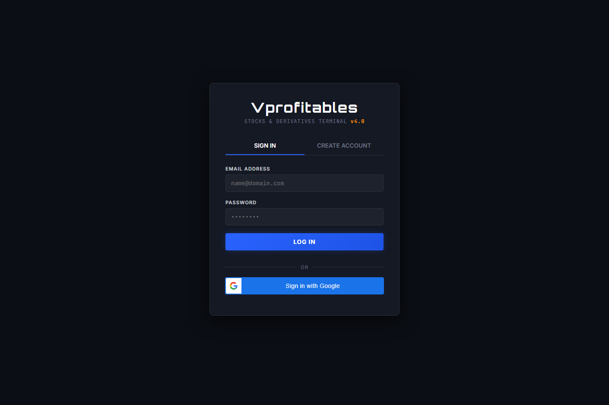
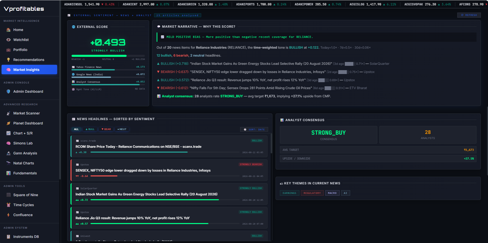

<div align="center">
  
  <h1>Vprofitables: Institutional Quant & AI Trading Engine</h1>
  <p><i>A proprietary-grade quantitative platform blending Machine Learning, Time-Frequency Analysis, and Microstructure Order Flow into a seamless Progressive Web App.</i></p>

  []()
  []()
  []()
  []()
</div>

---

## 📸 The Vprofitables Story (Platform Interface)

Vprofitables is designed as a single-page progressive web application. Here is a tour of the core modules:

### 1. Login Page
<div align="center">
  
  <br/><em>This is the Sign-up/Sign-in Page</em>
</div>
<br>


### 2. Market Overview (Home)
<div align="center">
  
  <br/><em>Live market gainers, losers, and quick research recommendations.</em>
</div>
<br>


### 3. AI Investment Advisor
<div align="center">
  
  <br/><em>Generates multi-stock portfolios using 5 layers of logic (Gann, ML, Natal, Fundamentals, Sentiment).</em>
</div>
<br>
 

### 4. News Sentiment Analysis
<div align="center">
  
  <br/><em>Tracks News Sentiments from 3 different platforms </em>
</div>
<br>


### 5. Quant & Charting Engine
<div align="center">
  
  <br/><em>Visualizes support/resistance levels, order blocks, and execution points directly on the chart.</em>
</div>

---

## 🧠 Model Engineering (The Alpha Generation)

Vprofitables does not rely on static retail indicators. Our core engine utilizes advanced financial mathematics to extract true market alpha.

### 1. Continual Learning Ensemble (`SGDClassifier`)
Instead of static predictive models that suffer from "concept drift," our AI uses an online learning architecture. At the end of every trading day, the model uses `partial_fit` to incrementally adjust its weights based on live trading outcomes. 

### 2. Time-Frequency Cycle Extraction (`CWT`)
We replaced standard Fourier Transforms with **Continuous Wavelet Transforms (Morlet Wavelets)**. This allows the engine to isolate non-stationary, localized market cycles (like a 45-day macroeconomic rhythm) that standard FFT equations miss.

### 3. Market-Neutral Statistical Arbitrage
When the broader market (NIFTY 50) goes flat, the engine scans for highly cointegrated equity pairs (e.g., HDFCBANK vs ICICIBANK). By calculating the spread `Z-Score`, the engine executes market-neutral mean-reversion trades.

---

## Database Architecture

The application currently uses two local database files for distinct paths. The
main `market_data_v2.db` SQLite file is the operational source of truth for
account/portfolio state, daily and intraday market history, option-chain data,
signals, news and ingestion records. SQLite is opened in WAL mode for local
read/write operation. The separate `data/market_data_1m.duckdb` database is
used by `core.timeseries_db` for the optional Yahoo Finance 1-minute poller and
VWAP strategy path. This DuckDB path is not the storage backend for the main
SQLite history tables.

The local analytical pilot can be built with
`python scripts/build_analytics_snapshot.py`. It opens SQLite read-only,
exports a six-year daily-price snapshot (with a buffer for five-year horizons) as versioned Parquet files under
`data/analytics/daily_prices/`, checks aggregate parity, and records SQLite vs
DuckDB query timings in the snapshot manifest. The active snapshot pointer is
published only after validation; prior snapshots are retained. Generated
analytical snapshots are ignored by Git and can be rebuilt from SQLite.

The measured pilot on 29 October 2026 exported 696,037 rows across six years
in about 42 seconds. A five-year nearest-close ranking query was slower on the
Parquet snapshot than SQLite (about 0.093 seconds vs 0.040 seconds), so that UI
path remains on SQLite. A full-universe three-year ML price-row read was about
1.68x faster on DuckDB/Parquet (2.08 vs 3.51 seconds) with exact row parity,
below the pilot's 2x adoption gate. The Parquet lane therefore remains an
opt-in, measured pilot and is not yet used by production calculations. Keep
SQLite authoritative for user and portfolio writes.

---

## 🧪 Institutional Backtesting & Evaluation

We don't trust standard backtests. Vprofitables employs rigorous statistical methods to prevent p-hacking (curve fitting).

*   **Monte Carlo Permutations:** Shuffles the sequence of historical trade returns 10,000 times to simulate alternative market realities, outputting the **True Maximum Drawdown (95% CI)**.
*   **Deflated Sharpe Ratio (DSR):** Mathematically discounts the Sharpe Ratio based on the variance and the number of backtest iterations run, ensuring the strategy is statistically significant.

---

## 🚀 One-Click Deployment

Run Vprofitables on any machine (Windows, Mac, Linux) seamlessly using Docker.

### 1. Via Docker (Recommended)
```bash
git clone https://github.com/chirag-kaura/vprofitables.git
cd vprofitables
docker-compose up --build -d
```
Navigate to [http://localhost:8080](http://localhost:8080) to access the Terminal.

### 2. Via Python (Locally)
```bash
pip install -r requirements.txt
python app.py
```

## 🤝 Contributing
Open-sourced for the quantitative finance community. Pull requests for new alpha strategies and broker API integrations (Zerodha, Interactive Brokers) are welcome!

## 📝 License
MIT License.
