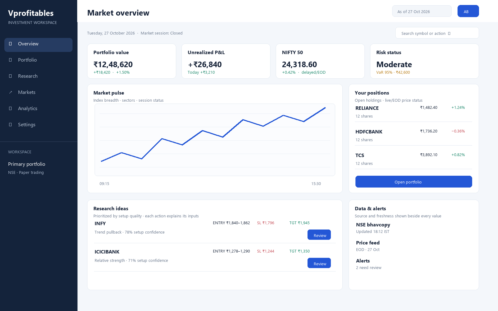
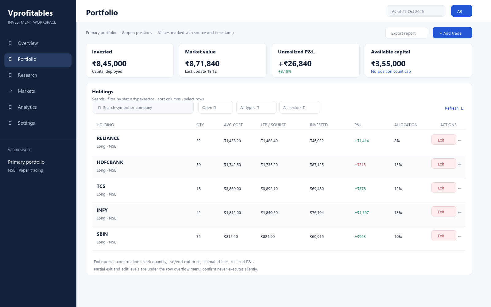

# Vprofitables Platform Redesign Plan

**Prepared:** 27 October 2026  
**Purpose:** Senior product design and technical discovery plan for a complete platform redesign.  
**Mode:** Planning and source review only. This document and the accompanying schematic images do not change application behavior.

## Executive summary

The product has broad capability across portfolio tracking, market research, technical analysis, risk, trade simulation and administration. The current experience exposes those capabilities as many separate page modules inside a shared shell. A redesign should make the common tasks predictable: understand account state, inspect a position or idea, take an action with clear consequences, and verify the result.

The main design opportunity is to establish one information architecture, one set of page and data patterns, and clear freshness/provenance labels for financial values. The current shared shell is a dark, fixed-width sidebar plus dense page templates, most of which define their own markup and styles. That creates drift in spacing, controls, responsive behavior, terminology, empty states and action feedback. The recommended direction is a calmer workspace with a persistent but collapsible navigation, a shared page header, consistent filter/action areas, reusable tables and charts, and progressive disclosure for advanced analysis.

This source review maps the frontend API calls and the server-side response contracts. It does **not** prove that each request succeeds against a running server or that each handler reads/writes the intended database rows. Those claims require runtime validation with an authenticated test account, browser network traces, server logs and before/after database checks. This distinction is made throughout the report.

## Scope and evidence

### Reviewed

- The SPA shell and shared styles/scripts in `pages/_html_head.html` and `pages/_shared.js`.
- Twenty page modules: admin, advisor, analytics, auth, chart, dashboard, fundamentals, Gann, natal, onboarding, overview, portfolio, research, risk, scanner, sentiment, Simons, tools, trading and watchlist.
- Client endpoint references in each page module, the API response contracts in `core/api_contracts.py`, and the existing manual QA report for known integration/security risks.
- Two static desktop wireframes for Overview and Portfolio.

### Not established by this review

- Pixel-level rendered state at every viewport, browser, zoom level, user role or data condition. Source styles were inspected, but no comprehensive visual browser pass was performed.
- Live service availability, request status, payload correctness, database persistence, market-feed freshness or third-party provider reliability.
- That every calculated metric is financially correct. Formula and source validation belongs in the data/API workstream with product and quant owners.

### Source observations

- The shell defines a 240 px sidebar, 24 px page padding, a sticky full-height desktop rail, and a 900 px mobile navigation breakpoint. Shared card grids change at 1100 px and 700 px. The page templates also contain extensive page-local markup and inline styles.
- `core/api_contracts.py` documents response key expectations for a subset of endpoints, including overview, portfolio, risk, watchlist, market depth, alerts, advisor plan and analytics. It does not provide documented contracts for many other page calls.
- The existing QA report notes that contract assertion failures are logged while a response may still be returned, and documents authentication/ownership concerns in the current route configuration. Those are cross-functional release risks, not visual styling issues.
- Many frontend mutations are made through a shared fetch helper. The source indicates most are GET-style requests, while a limited set use POST. The backend may currently dispatch those requests, but state-changing operations should be reviewed and moved to explicit mutation semantics with ownership, CSRF/authentication and idempotency considerations.

## Current experience: cross-platform findings

| Area | Current pattern / issue | Redesign response |
|---|---|---|
| Information architecture | A large number of specialist destinations are presented in one long navigation structure. Similar concepts appear under multiple labels (research, market insights, advanced research, quant tools, portfolio desk). | Reorganize around user tasks: Overview, Portfolio, Research, Markets, Analysis tools, Activity, Settings. Keep specialist tools grouped and searchable. Use role/permission-aware navigation without hiding deep links from authorized users. |
| Page consistency | Page modules are independently authored and often use local styles and controls. | Establish shared page templates, controls, spacing tokens, table patterns, form validation, loading/empty/error states and action confirmation patterns. |
| Density | Several research and analytics pages contain many panels, metrics and controls at once. | Put the primary decision and its next action first. Use tabs/filters for secondary work and expandable sections for advanced metrics. |
| Financial trust | Values can be hard to interpret without a consistent timestamp, source, currency, market/session state or delayed/EOD indicator. | Pair every price/metric with source and “as of” information; distinguish live, delayed, EOD, stale and unavailable. Give calculated metrics an explanation/source link. |
| Action feedback | A trading or portfolio action has meaningful consequences and must communicate progress, failure and final state. | Use a standard action lifecycle: review → validate → submit → pending/success/failure → refreshed position/activity. Prevent duplicate submission and show a traceable order/activity record. |
| Responsive behavior | The shell has mobile navigation behavior, but each page’s complex tables and charts need a page-level mobile strategy. | Convert tables to compact row cards or controlled horizontal scrolling with pinned identity/action fields; prioritize content for 390 px screens and touch interactions. |
| Accessibility | Source review alone cannot establish contrast, keyboard support, focus visibility, screen reader names or chart alternatives. | Include WCAG 2.2 AA checks, keyboard-only tasks, focus order, semantic headings, labels, non-color status indicators and accessible chart summaries. |
| Error states | Financial pages need explicit stale-data, partial-data, no-data and service-failure states instead of blank/ambiguous panels. | Define standard states and recovery actions per endpoint; preserve user input after recoverable errors. |

## Recommended design system and layout grid

The supplied images are structural wireframes, not final visual designs or measured screenshots. They demonstrate hierarchy and relative placement. Values below are the proposed handoff grid; final dimensions should be verified against the chosen typography, content and supported viewport matrix.

### Desktop shell (1440–1600 px reference)

| Element | Proposed specification |
|---|---|
| Left navigation | 248 px expanded, 72 px collapsed; fixed to viewport height. Group labels and active page state remain clear. On smaller screens it becomes an accessible overlay drawer. |
| Top bar | 64 px high; breadcrumb/page context left; global symbol/action search, market/session status, help and profile controls right. Keep account/date context visible where it affects figures. |
| Main content | Fluid width; maximum content width 1440 px; centered when the viewport is wider. 24 px outer gutter at desktop, 16 px at tablet, 16 px mobile. |
| Grid | 12 columns; 16 px column gap; 24 px vertical section gap. Main cards use 20–24 px interior padding. Use an 8 px base spacing scale. |
| Page heading | 28–32 px title, 14–16 px supporting context, primary action aligned to the right at desktop and placed immediately below title on mobile. |
| Type | Use a legible UI sans family with a defined type scale. Tabular numerals for prices/quantities; consistent rupee formatting; avoid all-caps labels for long text. |
| Color | Neutral light canvas with high-contrast text; one primary action hue; restrained semantic green/red/amber. Every status is also labeled with text/icon so color is not the sole signal. Dark theme can be a later tokenized variant. |
| Controls | 40–44 px minimum control height; consistent border, radius, focus ring, disabled state and validation placement. Destructive controls use explicit text and confirm context. |
| Charts | Shared axis/legend/tooltip conventions, selected range, currency/unit, source timestamp and accessible text summary. Never communicate gain/loss through color alone. |

### Responsive breakpoints

- **≥1200 px:** expanded navigation; use full dashboard grid and wide tables.
- **900–1199 px:** collapsed navigation; reduce secondary columns and use 2-column dashboard cards.
- **600–899 px:** drawer navigation; stack primary cards; simplify dense table columns.
- **<600 px:** single-column task flow; compact header; touch-friendly controls; holdings and recommendation rows become cards; forms/actions use full-width bottom action areas where appropriate.

### Reusable page states

Every endpoint-backed component should define: initial loading, refresh loading, no records, stale values, partial response, validation error, permission denied, network/service error, and success/updated state. Each state must say what happened and provide the next useful action. A page must not imply a successful trade or exit until the server confirms it.

## Page-by-page audit and proposed layout

Status language for the integration column: **Mapped** means a client endpoint reference is present in source; **Contract partial** means a response contract exists for a subset of that page’s calls; **Runtime unverified** means successful backend/database behavior has not been demonstrated here.

| Page | Current UX issues to validate / likely friction | Proposed layout and hierarchy | API/data integration review |
|---|---|---|---|
| **Overview** (`page_overview.py`) | Many market, portfolio, recommendation and risk sections compete for attention. Users may not know which values are current or which recommendation action is actionable. | 1) Header with selected portfolio, date/session and global search. 2) Four compact account/market/risk KPIs. 3) Market pulse and open-position summary. 4) Prioritized recommendation cards with thesis, entry/stop/target, freshness and Review action. 5) Alerts/activity and data-status panel. | Mapped: `overview_data`, `portfolio_get`, `portfolio_ai_insights`, `recommendations`, `risk_dashboard`, `watchlist_get`, `watchlist_add/remove`. Contract partial: overview, portfolio, risk, watchlist. Runtime unverified; check partial failures and consistent selected-account/date scope. |
| **Portfolio** (`page_portfolio.py`) | Holdings require dense numeric comparison; row actions (exit/edit/delete) are high impact and can be difficult to distinguish. Empty/loading states and refresh feedback need consistency. | Header + account selector and Add trade; summary metrics; filter/search/sort bar; holdings table with identity, quantity, average, current price/source/time, value, P&L, allocation and one clear action menu. Exit opens a reviewed quantity/price/estimated-fees sheet and a final confirmation; partial exit is explicit. Activity/history is a separate tab. | Mapped: `portfolio_get/add/modify/close/partial_exit/delete`, `price`. Contract partial: portfolio_get only. Runtime unverified. Trace every mutation response to persisted position/trade state, verify ownership and duplicate-submit behavior; ensure exit quantity/value and realized P&L reconcile. |
| **Research Recommendations** (`page_advisor.py`) | Recommendations can look like orders; rationale, confidence, risk and source date should be visible before action. A Buy button must preserve symbol/context when navigating. | Research list with filters and freshness; expandable idea detail with thesis, evidence, invalidation, entry/stop/target and sizing assumptions; primary Review trade action leads to a prefilled order ticket, never an implicit order. | Mapped: `advisor`, `advisor_plan`, `all_symbols`, `master_report`, `ml_status/train`, `portfolio_add`. Contract partial: advisor_plan. Runtime unverified. Confirm generated data provenance and that training/status actions are permission-gated and give task progress. |
| **Analytics** (`page_analytics.py`) | Multiple metrics/charts can be difficult to compare without definitions, date scope and benchmark context. | Filter strip (date range, portfolio, benchmark); return/equity chart; drawdown and key statistics; tabs for calendar, trades, sectors and best/worst; metric definitions on demand. | Mapped: `analytics_data`. Contract partial: subtype schemas exist. Runtime unverified. Validate each subtype, empty history, timezone/date boundaries, benchmark alignment and all formulas against known fixtures. |
| **Authentication** (`page_auth.py`) | Login and registration need clear error recovery, password visibility, loading state and accessible field validation. Any demo/admin shortcuts or credential disclosures must be removed before production. | Focused sign-in/up experience; explicit account recovery; provider sign-in with clear fallback; no dashboard navigation until session is verified. | Mapped: `auth/login`, `auth/google`, `config`, `onboarding/check`. Runtime unverified. Validate token issuance/expiry, redirects, error codes, user roles and backend protections. Existing QA report records critical auth concerns requiring engineering/security review. |
| **Chart / Trade ticket** (`page_chart.py`) | Chart analysis and trade execution are adjacent but distinct tasks; the order form must expose all required inputs, validation and server response. | Symbol/chart header with source and timeframe; chart as primary canvas; separate side ticket on desktop and bottom sheet on mobile. Buy/Sell, quantity, order type, price, risk summary, available capital, review and confirmation; clear result state and activity link. | Mapped: `price`, `quant`, `sentiment`, `risk_settings`, `portfolio_get/add/close/partial_exit`, `capital_topup`. Contract partial: portfolio/risk only. Runtime unverified. Verify symbol/date context, account buying power, order validation and durable trade record. |
| **Dashboard** (`page_dashboard.py`) | A separate dashboard destination may duplicate Overview and split user expectations. Content purpose and route relationship need clarification. | Decide whether this is a personalized home distinct from market Overview. If distinct, show user tasks, recent activity and saved work; otherwise merge into Overview and redirect legacy route. | Mapped: `dashboard`; no dedicated contract observed. Runtime unverified. Establish response schema and source, account scoping, empty state and relationship to Overview. |
| **Fundamentals** (`page_fundamentals.py`) | Deep financial data can become an unstructured long report. Data period, units, source, and stale status are essential. | Company header; valuation snapshot; tabs for financial statements, ratios, ownership/institutional flows and alerts; period selector; definitions and source disclosure beside each metric. | Mapped: `fundamentals`, `institutional`, symbols, price/quant, portfolio, risk settings, alerts, capital top-up. Contract coverage limited. Runtime unverified. Verify units, fiscal periods, corporate actions, provider gaps and alert persistence. |
| **Gann Analysis** (`page_gann.py`) | Specialist outputs may be opaque without explaining methodology, date assumptions and uncertainty. | Symbol/date inputs; concise result summary; chart overlay and levels; methodology/assumption disclosure; save/track record area with explicit data source. | Mapped: `analyze`, `gann_track_record`; no contract observed. Runtime unverified. Validate inputs, errors, result schema and tracked record persistence. |
| **Natal Charts / Cycles** (`page_natal.py`) | The page needs clear separation between user inputs, calculation outputs and market data; uncertainty and date/timezone handling can be unclear. | Input panel with date/time/timezone and symbol/context; generated cycle timeline; relevant events table; methodology and limitations disclosure; save/export only after preview. | Mapped: `cycles`, `natal`, `sq9`; no contract observed. Runtime unverified. Verify timezone/date validation and that output schema and provenance are explicit. |
| **Onboarding** (`page_onboarding.py`) | Multi-step setup can lose progress and may ask for preferences without explaining their use. | Short stepper: profile/preferences → watchlist → account mode → review; save progress; skip optional items; explicit completion and landing page. | Mapped: `onboarding/submit`, `watchlist_add`. Runtime unverified. Verify idempotent submission, authenticated ownership, persistence and resume behavior. |
| **Research Desk / RAG** (`page_research.py`) | Ingestion and Q&A need source traceability, progress, and clear distinction between retrieved facts and generated summaries. | Two workspaces: Documents (upload/ingestion status and source list) and Ask (question, answer, citations/snippets, freshness). Show ingest failures and retry controls. | Mapped: `llm_extract`, `rag_ingest`, `rag_qa`; no response contract observed. Runtime unverified. Validate upload limits, processing status, retrieval citations, user/document isolation and error behavior. |
| **Risk** (`page_risk.py`) | Risk indicators can alarm or reassure without definitions, portfolio scope and “as of” timestamp. | Risk summary and definitions; exposure by sector/position; drawdown/VaR charts; scenarios/limits; settings in a separate tab with impact preview. | Mapped: `risk_dashboard`, `all_symbols`. Contract partial: risk dashboard. Runtime unverified. Validate calculations against portfolio holdings and ensure any configured thresholds are reflected consistently. |
| **Scanner** (`page_scanner.py`) | Large result sets need explainable filters, source date and a way to inspect why a symbol matched. | Filter builder; saved scans; results table with signal reason and data freshness; symbol details drawer; explicit action to add to watchlist or review trade. | Mapped: `scanner`, `institutional`; no dedicated contract observed. Runtime unverified. Validate filter parameters, pagination, empty responses and symbol references. |
| **Sentiment** (`page_sentiment.py`) | Sentiment, market breadth and external sources may mix time windows or confidence levels. | Sentiment overview with period/source filters; market/sector summary; trend; source-level news/sentiment feed; accuracy panel and methodology tooltip. | Mapped: `external_sentiment`, `market_brain_digest`, sector detail, `sentiment`, trend/accuracy, `institutional`, `price_history`. Runtime unverified. Validate timestamps, source attribution, stale feeds and missing-provider behavior. |
| **Simons Lab** (`page_simons.py`) | Quant outputs can look authoritative without showing sample size, benchmark, look-ahead controls or uncertainty. | Strategy setup; assumptions and date range; run controls/progress; result summary with benchmark/drawdown/sample count; equity curve and trade list; save/export. | Mapped: `price`, `quant`; no dedicated contract observed. Runtime unverified. Verify adjusted prices, date bounds, survivorship/look-ahead handling and repeatability. |
| **Tools / Instruments DB** (`page_tools.py`) | Utility actions and instrument lookup may be mixed, with unclear consequences for scheduler actions. | Searchable instrument catalog as primary view; detail drawer for instrument metadata; separate scheduled jobs panel with status, last run and confirm/retry controls. | Mapped: `instruments_full`, symbols/prices, advisor, scheduler status/trigger. Runtime unverified. Verify list volume/pagination, scheduler role restrictions, job progress and action audit history. |
| **Trading / Signals** (`page_trading.py`) | Signal screens can blur “research signal” with “order.” Entry levels and setup conditions need explicit validation. | Signal list grouped by setup; chart and rationale detail; Review trade action preloads ticket; monitor/history tab. Label all signals as informational until separately confirmed. | Mapped: `forward_signal`, `intraday_vwap_pullbacks`, `trend_pullbacks`; no contract observed. Runtime unverified. Validate signal timestamps, level geometry, duplicate signals and persistence/history. |
| **Watchlist** (`page_watchlist.py`) | Watchlists can become a dense quote table; alert setup and list management need feedback. | Watchlist selector; search/add; table of symbol, price/change/source/time, alert state and quick view; alert editor in a side panel; remove with undo. | Mapped: `watchlist_get/add/remove`, alerts, `market_depth`, `price_history`, symbols. Contract partial: watchlist, alerts, depth. Runtime unverified. Verify list ownership, quote freshness, alert CRUD and add/remove idempotency. |
| **Admin** (`page_admin.py`) | User and feature management have destructive/high-impact controls; role changes need clear scope and audit trail. | Admin-only workspace; summary; searchable users table; role/feature changes via reviewed dialogs; notification configuration and test controls with status; audit history. | Mapped: `admin/users`, role/feature lock, notification config load/save/test. Runtime unverified. Require verified admin permissions server-side, user scoping, audit logging and safe notification test handling. |

### Navigation plan

Suggested first-level navigation:

1. **Overview** — account summary, market pulse and prioritized next actions.
2. **Portfolio** — holdings, transactions and trade history.
3. **Research** — recommendations, research desk, scanner and watchlist.
4. **Markets** — sentiment, fundamentals and instrument reference.
5. **Analysis** — chart, risk, analytics, strategy lab and specialist tools.
6. **Activity** — orders, exits, alerts and background job outcomes.
7. **Settings** — account, preferences and integrations; Admin appears only for authorized roles.

Keep specialist pages discoverable through grouped subnavigation and global search. Decide whether Dashboard is a distinct task; if it repeats Overview, consolidate it. Preserve direct links/bookmarks during migration.

## API, backend and database review plan

### What source mapping can say today

Frontend page modules reference the endpoint groups listed in the table. `core/api_contracts.py` provides response-shape checks for a subset. This demonstrates intended route names and some expected response keys; it does not demonstrate that the calls are accepted, that returned data is correct, or that the database mutation was committed.

The existing QA report includes critical authentication/authorization findings. Every redesign and runtime test must use a protected test environment and must confirm that account-scoped API calls enforce user ownership. A polished UI cannot compensate for a route that returns another user’s portfolio or accepts an unauthorized mutation.

### Integration validation matrix

For every page/API call, create an endpoint record with: page/component, HTTP method, path, auth requirement, request schema, response schema, database/provider dependency, timeout/retry behavior, freshness policy, UI state mapping, ownership rule and test evidence. Mark a call **Pass** only after it has runtime evidence.

1. **Inventory:** Extract client endpoints and compare with server route dispatch. Flag orphan routes, missing routes, name mismatches and unused endpoints.
2. **Contract:** Define request/response schemas for all calls, including error payloads. Fail validation visibly in development/CI; do not return a success-shaped payload after a contract failure.
3. **Method and safety:** Use GET for reads and POST/PATCH/DELETE for mutations. Verify authentication, ownership, CSRF protections where relevant, input validation, idempotency and audit records.
4. **Database trace:** For each read, identify the table/query or provider. For each mutation, capture pre-state, request, response, post-state and relevant trade/activity rows. Verify transaction boundaries and rollback on failure.
5. **End-to-end state:** Confirm that the frontend updates only after server confirmation, handles duplicate clicks and refreshes from the canonical server response.
6. **Reliability:** Test timeout, malformed JSON, 4xx/5xx, partial provider outage, stale data and reconnect behavior. Preserve filters and form values where safe.
7. **Financial correctness:** Reconcile portfolio totals, quantities, realized/unrealized P&L, fees, allocation and risk figures against a controlled fixture and approved formulas.
8. **Observability:** Correlate client request IDs with server logs and database transactions without logging credentials or sensitive account data.

### Page API map

| Page | Endpoint families referenced |
|---|---|
| Overview | `overview_data`, portfolio read, AI insights, recommendations, risk dashboard, watchlist read/add/remove |
| Portfolio | portfolio read/add/modify/close/partial exit/delete, price |
| Advisor | advisor, advisor plan, symbols, master report, ML status/train, portfolio add |
| Analytics | analytics data |
| Auth | login, Google auth, config, onboarding check |
| Chart | price, quant, sentiment, risk settings, portfolio read/add/close/partial exit, capital top-up |
| Dashboard | dashboard |
| Fundamentals | fundamentals, institutional, symbols, price/quant, portfolio, risk settings, alerts, capital top-up |
| Gann | analyze, Gann track record |
| Natal | cycles, natal, SQ9 |
| Onboarding | submit onboarding, watchlist add |
| Research | LLM extract, RAG ingest, RAG Q&A |
| Risk | risk dashboard, symbols |
| Scanner | scanner, institutional |
| Sentiment | external sentiment, market brain digest/sector detail, sentiment, trend/accuracy, institutional, price history |
| Simons | price, quant |
| Tools | instruments, price, advisor, scheduler status/trigger, symbols |
| Trading | forward signal, intraday VWAP pullbacks, trend pullbacks |
| Watchlist | watchlist read/add/remove, alerts, market depth, price history, symbols |
| Admin | users, role/feature controls, notification configuration/test |

## Wireframe concepts

These are layout sketches for review, not final brand or implementation assets.

### Overview

### Portfolio

The Overview sketch gives the account and market state priority, then positions and research ideas. The Portfolio sketch prioritizes holdings, source/freshness, search/filter, and a deliberate exit action. The next design phase should add the order-ticket, analytics, research detail and mobile states before visual styling is approved.

## What a senior product design team should do next

### Phase 1 — Product discovery and risk alignment

- Interview active users and observe task completion for the highest-frequency workflows: check portfolio, review recommendation, place paper trade, exit/partially exit, inspect risk, set alert and find research evidence.
- Agree on user roles, account model, paper/live boundaries, market-data expectations and terminology with product, engineering, quant and security owners.
- Define success measures: task completion, time-to-action, order/exit error rate, data freshness comprehension, API failure recovery, accessibility and support contacts.
- Inventory existing analytics and error telemetry. Avoid collecting sensitive financial data unnecessarily.

### Phase 2 — UX and integration audit

- Build a route/page/component inventory and record desktop/tablet/mobile states.
- Run task-based usability sessions and a heuristic/accessibility review.
- Capture current page screenshots at 1440×900, 1280×800, 768×1024 and 390×844, including loading, error, empty and populated states.
- Pair with engineering to trace the endpoint matrix above. Use controlled test accounts and a disposable dataset; document each tested request and persisted effect.
- Prioritize blockers by user harm: wrong/unclear financial state, unsafe action, data mismatch, inaccessible control, then visual consistency.

### Phase 3 — Information architecture and interaction design

- Validate navigation labels and grouping with card sorting/tree testing.
- Map primary flows and error recovery before drawing high fidelity screens.
- Define the trade ticket and portfolio exit lifecycle in explicit state diagrams.
- Prototype responsive tables, charts, alerts, filters and progressive disclosure.
- Review with compliance/security for terminology and data handling where required.

### Phase 4 — Design system and screen design

- Tokenize color, typography, spacing, elevation, focus, breakpoints and data visualization.
- Build reusable components and page templates with empty/loading/error/success examples.
- Produce page-level desktop and mobile designs for all 20 modules, including dialogs, drawers and high-risk states.
- Generate annotated redlines and interaction specs; include keyboard/focus behavior and content rules.
- Use design review checkpoints with product, engineering and data owners; log decisions and unresolved questions.

### Phase 5 — Validation and handoff

- Test clickable prototypes with representative users before implementation.
- Run accessibility checks and manual keyboard/screen reader reviews.
- Handoff component specs, tokens, API field dependencies, error states and acceptance criteria.
- During implementation, review builds against specs at each supported viewport and compare the actual API state to the UI state.
- Retest the full task flows and reconcile server/database effects before release.

## Proposed acceptance criteria

- Every first-level destination has a clear purpose and one primary task; duplicate Overview/Dashboard purpose is resolved.
- All 20 page modules have approved desktop and mobile layouts plus loading, empty, stale, permission and error states.
- Every market/portfolio value shows appropriate unit, date/time, source and freshness status.
- A recommendation can be reviewed and converted into a prefilled trade ticket without losing symbol, side or analysis context.
- Buy/sell/exit/partial exit actions require valid inputs, clear confirmation and server acknowledgment; success is reflected by refreshed canonical state and activity history.
- Every API call has a documented request/response/error contract and a runtime test result; account data routes enforce authentication and ownership.
- Every state-changing endpoint uses an appropriate mutation method and validates server-side; duplicate submission does not create duplicate trades.
- Portfolio totals and P&L reconcile to controlled fixtures and approved calculation rules.
- Core workflows pass at desktop, tablet and mobile sizes and meet WCAG 2.2 AA review criteria.
- No page reports success when its endpoint or persistence step failed; recoverable errors give a clear next action.

## Deliverables for the redesign engagement

1. Validated task/persona and role summary (grounded in research, not assumed demographics).
2. Current-state UI inventory and annotated audit for each page and responsive state.
3. Information architecture and route migration map.
4. Endpoint/data dependency matrix with runtime verification evidence and ownership/security findings.
5. User flows and interaction state diagrams for trade entry, exit, watchlist/alerts, research and onboarding.
6. Tokenized design system and reusable component library.
7. High-fidelity responsive screens for every module, including edge states.
8. Clickable prototype and usability findings with prioritized changes.
9. Annotated handoff specs and acceptance checklist for design QA.
10. Release validation report tying browser outcomes to backend responses and persisted records.

## Conclusion

The project is ready for a structured redesign discovery phase, but the current source review cannot certify endpoint-to-database correctness. The first concrete deliverable should be the combined page/API inventory and runtime trace, alongside user research on the trading and portfolio tasks. The wireframes establish a proposed hierarchy; they should be validated with users and engineering before final styling or implementation.
